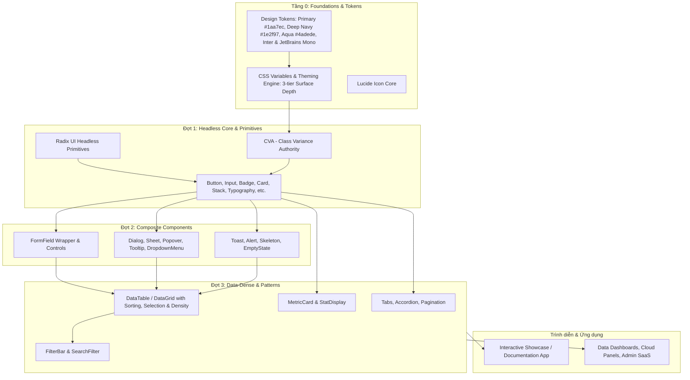

# Kiến trúc Kỹ thuật: Belp UI Kit

## 1. Tổng quan Kiến trúc (Architectural Overview)

Belp UI Kit được thiết kế theo mô hình phân tầng **Component Driven Architecture**, kết hợp giữa nền tảng Headless Accessibility và hệ thống Design Tokens định hình phong cách độc bản lấy cảm hứng từ bộ màu D3 Design (`#1aa7ec`, `#1e2f97`, `#4adede`, `#797ef6`, `#7dd6f6`):

---

## 2. Bảng Màu Thương hiệu Cốt lõi (D3 Design Color Palette)

Hệ thống token màu chủ đạo được trích xuất và tối ưu chuẩn HSL từ `https://d3design.vn/uploads/03.jpg`:

| Vai trò | Mã Hex | Mã RGB | Mã HSL | Ý nghĩa & Vị trí ứng dụng |
|---|---|---|---|---|
| **Primary (Chủ đạo)** | `#1aa7ec` | `rgb(26, 167, 236)` | `200 85% 51%` | Màu thương hiệu chính: Nút Solid, Focus ring, Tab active, Link |
| **Deep Navy (Nền tối)** | `#1e2f97` | `rgb(30, 47, 151)` | `232 67% 35%` | Màu nền canvas và card trong Dark Mode (Midnight Navy theme) |
| **Aqua Mint (Điểm nhấn)** | `#4adede` | `rgb(74, 222, 222)` | `180 69% 58%` | Màu trạng thái Active, Healthy, Live indicators, Glowing dots |
| **Periwinkle (Phụ trợ)** | `#797ef6` | `rgb(121, 126, 246)` | `238 87% 72%` | Huy hiệu trạng thái, icon phụ trợ, đường viền tương tác |
| **Sky Ice (Mềm dịu)** | `#7dd6f6` | `rgb(125, 214, 246)` | `196 87% 73%` | Màu thông tin (Info badge), nền hover phụ trợ, text accents |

---

## 3. Lựa chọn Công nghệ (Technology Stack)

- **Ngôn ngữ**: TypeScript (Strict Mode).
- **Framework UI**: React 18 / 19.
- **Styling**: Tailwind CSS + CSS Variables (`colors.css`, `typography.css`, `spacing.css`).
- **Phông chữ**:
  - **Inter**: Dành cho toàn bộ tiêu đề (Headings), nhãn nút (Labels) và thân bài (Body) với độ sắc nét tuyệt đối.
  - **JetBrains Mono**: Dành cho mã lệnh, số liệu kỹ thuật, hashes và endpoints.
- **Headless Components**: Radix UI Primitives (`@radix-ui/react-*`).
- **Icons**: `lucide-react`.
- **Bundler**: Vite + `vite-plugin-dts`.

---

## 4. Nguyên tắc Thiết kế (SOLID Principles)

1. **Single Responsibility (SRP)**: Tách rời logic điều khiển (Headless WAI-ARIA) và style hiển thị (Tailwind CVA).
2. **Open / Closed (OCP)**: Cho phép mở rộng qua prop `className` kết hợp tiện ích `cn()`, không sửa mã lõi ổn định.
3. **Liskov Substitution (LSP)**: Các biến thể `size` hay `variant` tuân thủ đầy đủ thuộc tính HTML gốc.
4. **Interface Segregation (ISP)**: Phân tách compound components (`CardHeader`, `CardTitle`, `CardContent`, `CardFooter`).
5. **Dependency Inversion (DIP)**: `DataTable` phụ thuộc vào interface trừu tượng `ColumnDef<T>`, độc lập với cấu trúc dữ liệu cụ thể.
