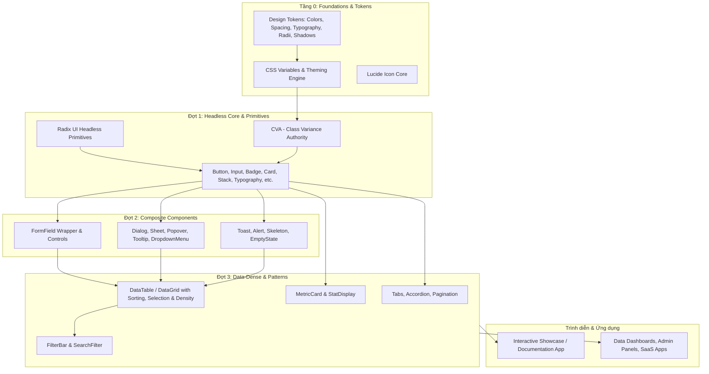

# Kiến trúc Kỹ thuật: Belp UI Kit

## 1. Tổng quan Kiến trúc (Architectural Overview)

Belp UI Kit được thiết kế theo mô hình phân tầng **Component Driven Architecture**, kế thừa triết lý từ `building-component-library.md`:



---

## 2. Lựa chọn Công nghệ (Technology Stack)

| Hạng mục | Công nghệ | Lý do lựa chọn |
|---|---|---|
| **Ngôn ngữ** | TypeScript (Strict mode) | Type safety hoàn hảo cho props, autocomplete tốt cho dev |
| **Framework nền tảng** | React 19 / 18 | Chuẩn phổ biến nhất, hệ sinh thái phong phú |
| **Styling & Tokens** | Tailwind CSS v4 / v3 + CSS Variables | Viết class tiện lợi, định nghĩa token tập trung qua biến CSS gốc |
| **Biến thể Component** | `class-variance-authority` (CVA) + `clsx` + `tailwind-merge` | Quản lý variants & sizes an toàn, tự động giải quyết xung đột Tailwind classes |
| **Headless Primitives** | Radix UI (`@radix-ui/react-*`) | Giải quyết ~70% bài toán phức tạp về WAI-ARIA, Keyboard nav, Focus trap, Portal |
| **Icon Set** | `lucide-react` | Nhất quán về kích thước (24x24 viewBox), nét vẽ (stroke 2px/1.5px), sắc nét |
| **Bundler & Build Tool** | Vite + `vite-plugin-dts` | Build thư viện ra ESM/CJS cực nhanh, tự động xuất file `.d.ts` đầy đủ |
| **Showcase / Docs** | Ứng dụng Playground tương tác trực tiếp (Interactive Component Gallery) | Kiểm thử trực quan tức thì mọi state, copy code mẫu, kiểm tra light/dark theme |

---

## 3. Cấu trúc Thư mục Dự án (Project Structure)

```text
belp-ui-kit/
├── .env.example
├── .gitignore
├── README.md
├── package.json
├── tsconfig.json
├── tsconfig.node.json
├── vite.config.ts
├── docs/
│   ├── REQUIREMENTS.md
│   ├── ARCHITECTURE.md
│   └── TASKS.md
├── src/
│   ├── index.ts                 # Điểm xuất (Export Entrypoint) chính của thư viện
│   ├── tokens/                  # Tầng 0: Định nghĩa Design Tokens
│   │   ├── colors.css           # Bảng mã màu CSS Variables
│   │   ├── typography.css       # Quy chuẩn font chữ, font scale
│   │   ├── spacing.css          # Quy chuẩn khoảng cách, border-radius, shadows
│   │   └── index.css            # File tổng hợp tokens đưa vào dự án
│   ├── utils/
│   │   └── cn.ts                # Helper hợp nhất class (clsx + twMerge)
│   ├── components/              # Các tầng components
│   │   ├── primitives/          # Đợt 1
│   │   │   ├── button/
│   │   │   ├── input/
│   │   │   ├── badge/
│   │   │   ├── typography/
│   │   │   ├── card/
│   │   │   ├── stack/
│   │   │   └── ...
│   │   ├── composite/           # Đợt 2
│   │   │   ├── form-field/
│   │   │   ├── dialog/
│   │   │   ├── tooltip/
│   │   │   ├── toast/
│   │   │   ├── alert/
│   │   │   └── ...
│   │   └── data/                # Đợt 3
│   │       ├── data-table/
│   │       ├── pagination/
│   │       ├── filter-bar/
│   │       └── metric-card/
│   └── showcase/                # Ứng dụng Playground & Interactive Catalog
│       ├── App.tsx
│       ├── main.tsx
│       └── pages/
```

---

## 4. Nguyên tắc Thiết kế Code (SOLID & Clean Code)

1. **Single Responsibility (SRP)**:
   - Tách biệt logic headless (hành vi) và style (hiển thị).
   - Component không đảm nhiệm việc fetch data từ backend; chỉ nhận `props` thuần túy.
2. **Open / Closed (OCP)**:
   - Các component mở rộng thuộc tính gốc HTML tương ứng (`React.ButtonHTMLAttributes`, `React.InputHTMLAttributes`).
   - Hỗ trợ prop `className` ghi đè style qua hàm `cn()`.
3. **Liskov Substitution (LSP)**:
   - Biến thể kích thước (`sm`, `md`, `lg`) hay dạng thức (`solid`, `outline`, `ghost`) không làm thay đổi hành vi cơ bản của component gốc.
4. **Interface Segregation (ISP)**:
   - Chia nhỏ các sub-component lồng nhau theo chuẩn Compound Component (ví dụ: `Card`, `CardHeader`, `CardTitle`, `CardContent`, `CardFooter`) thay vì dồn tất cả vào 30 props trong 1 hàm duy nhất.
5. **Dependency Inversion (DIP)**:
   - Phụ thuộc vào các interface trừu tượng (`DataTableColumn<T>`, `FormFieldProps`) thay vì cấu trúc dữ liệu cứng.

---

## 5. Quy chuẩn Trạng thái Component (Component States Checklist)

Mọi component tương tác đều phải thể hiện rõ các trạng thái sau:
- **Default**: Bình thường.
- **Hover**: Rê chuột.
- **Focus / Focus-visible**: Viền focus rõ nét, chuẩn accessibility cho bàn phím (`ring-2 ring-primary ring-offset-2`).
- **Active / Pressed**: Cảm giác nhấn vật lý.
- **Disabled**: Độ mờ (opacity-50), chuột dạng `not-allowed`, vô hiệu hóa sự kiện.
- **Loading**: Hiển thị Spinner, giữ nguyên kích thước không nhảy layout (layout shift), tạm khóa click.
- **Error**: Viền đỏ semantic, thông điệp lỗi kèm icon cảnh báo.
